# 📊 Data Jobs Salary Analysis — Excel, Power Query & Tableau

## 📌 Project Overview

This project analyses **46,637 data-job records** to explore salary trends, job families, employment characteristics, work arrangements and company locations.

The project demonstrates an end-to-end analytics workflow using:

* **Power Query** for data cleaning and transformation
* **Excel** for exploratory analysis, PivotTables and visualisation
* **Tableau Public** for dashboard development and data storytelling

The objective was not simply to produce charts, but to take a raw dataset through a complete analytical workflow and turn it into meaningful insights.

---

## 🎯 Project Background

As part of my transition into **data analytics**, I wanted to strengthen my practical skills by working with an independent dataset and applying the techniques I had been developing across data-cleaning, analysis and visualisation projects.

For this project, I sourced a separate dataset from **Kaggle** and independently developed the workflow from raw data through to final dashboards.

This allowed me to practise the complete process of:

**Data Preparation → Transformation → Analysis → Visualisation → Data Storytelling**

---

## 🎯 Project Objectives

The main objectives were to:

* Clean and validate a large real-world dataset
* Transform coded fields into more meaningful categories
* Classify hundreds of individual job titles into broader job families
* Analyse salary patterns across multiple dimensions
* Explore job-market distributions and geographic trends
* Build clear Excel-based analysis and visualisations
* Develop professional dashboards in Tableau Public
* Communicate findings in a format suitable for a professional portfolio

---

## 📂 Dataset

The dataset was sourced from **Kaggle** and contains **46,637 records** covering data-related employment.

### Dataset characteristics

* **46,637** job records
* **2020–2025** work years
* **317** distinct job titles
* **20** job-family categories created during classification
* Salary information standardised to **USD**
* Employment type, experience level and company size
* Work arrangement information
* Employee residence and company location

> **Note:** The dataset does not contain a skills field, so the analysis focuses on salaries, roles, employment characteristics, work arrangements and locations.

---

## 🧹 Data Cleaning & Transformation

### Power Query

Power Query was used to prepare the raw dataset for analysis.

The main transformation process included:

1. Importing the raw dataset
2. Reviewing column quality and data structure
3. Removing duplicate records
4. Validating the final record count
5. Creating conditional columns to make coded fields easier to interpret
6. Cleaning and standardising job-title information
7. Creating job-family classifications
8. Producing analysis-ready datasets
9. Checking the final dataset for errors, nulls and blanks

### Raw Data Import

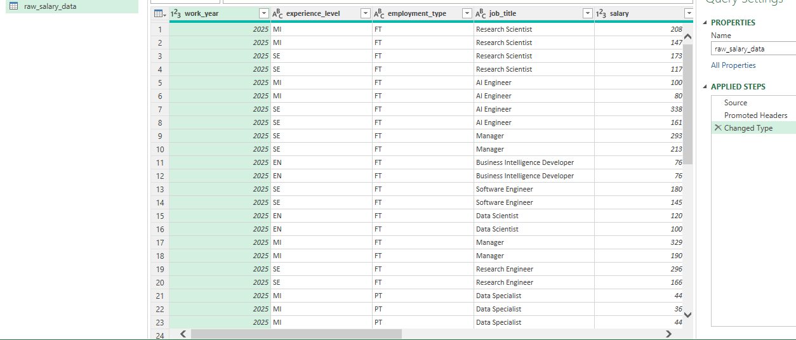

---

### Removing Duplicate Rows & Record Count

The final dataset was validated at **46,637 records** after duplicate removal.

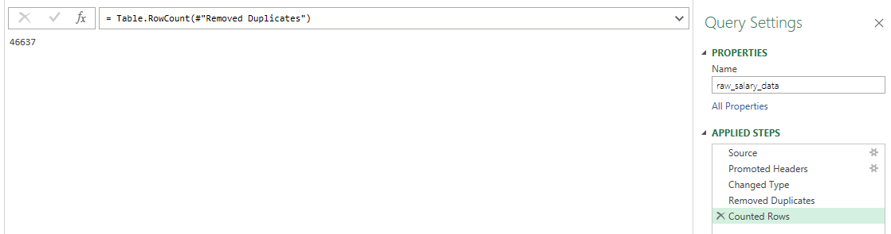

---

### Job Title Cleaning

Job titles were reviewed and cleaned before classification into broader job families.

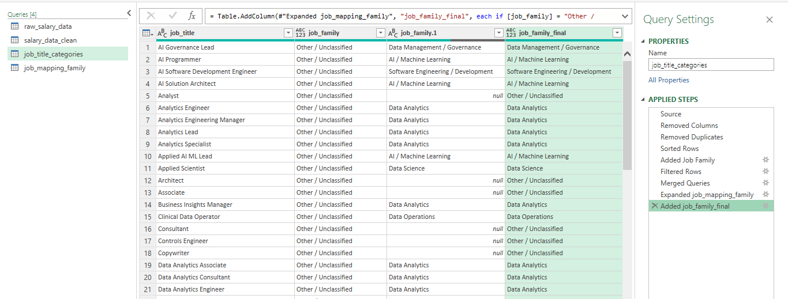

---

### Salary by Year

Analysed salary trends across the 2020–2025 period to examine how average and median salaries changed over time. This analysis provides a year-by-year comparison of salary levels within the dataset.

---

### Job Family Distribution

Individual job titles were grouped into **20 broader job-family categories** to make the analysis more meaningful.

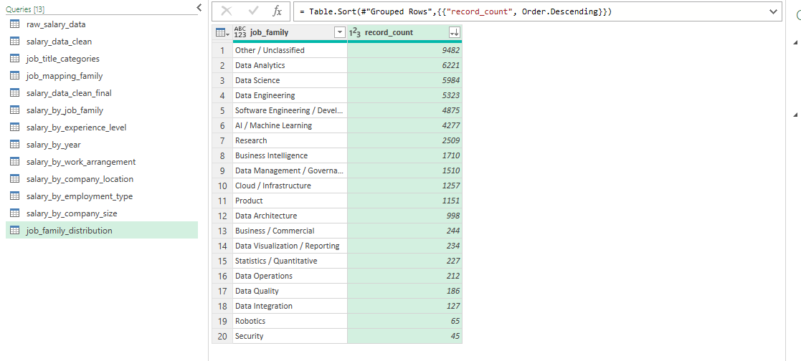

---

### Salary by Job Family

Salary analysis was performed across the classified job families using average and median salary measures.

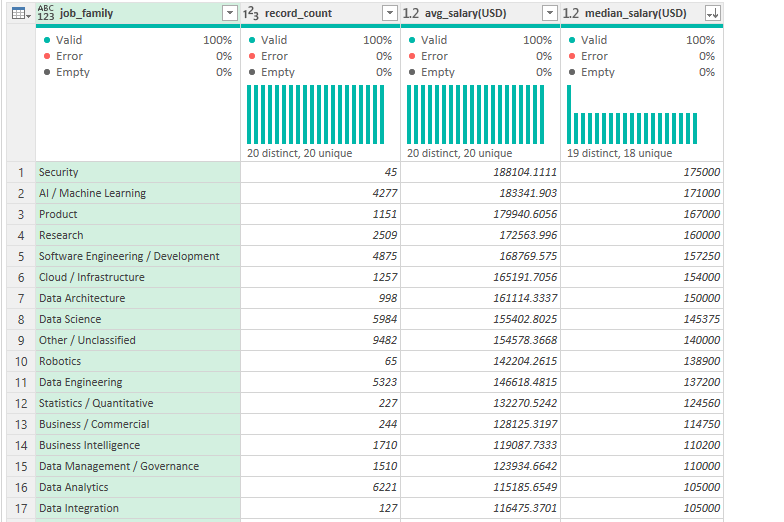

---

### Salary by Work Arrangement

Salary patterns were also analysed across different work arrangements.

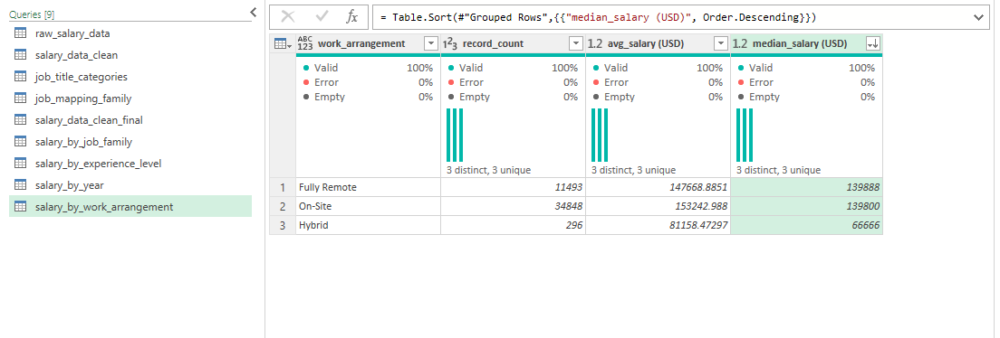

---

## 🏷️ Job Title Classification

The original dataset contained **317 distinct job titles**.

To make the analysis more useful, job titles were grouped into **20 broader job families**, including:

* Data Analytics
* Data Science
* Data Engineering
* Software Engineering
* AI / Machine Learning
* Research
* Business Intelligence
* Data Management
* Cloud
* Product
* Data Architecture
* Data Visualization
* Statistics
* Data Operations
* Data Quality
* Data Integration
* Robotics
* Security
* Business / Commercial
* Other / Unclassified

This transformation allowed salary and job-distribution patterns to be analysed at a higher level rather than relying solely on individual job titles.

**Other / Unclassified:** This category was retained for job titles that could not be confidently assigned to one of the defined job families. 

This avoids forcing ambiguous or specialised roles into potentially misleading categories and preserves them for completeness in the overall analysis.

---

## 📊 Exploratory Data Analysis

The cleaned dataset was analysed across several dimensions.

### Salary Analysis

Salary was examined by:

* Job family
* Work year
* Work arrangement
* Employment type
* Experience level
* Company location
* Company size

### Job-Market Analysis

Job distribution was examined by:

* Job family
* Experience level
* Employment type
* Work arrangement
* Company location
* Company size

---

## 📈 Excel Analysis

Excel was used to perform exploratory analysis using **PivotTables, formulas and charts**.

### Salaries by Job Category

Average and median salaries were compared across the classified job families.

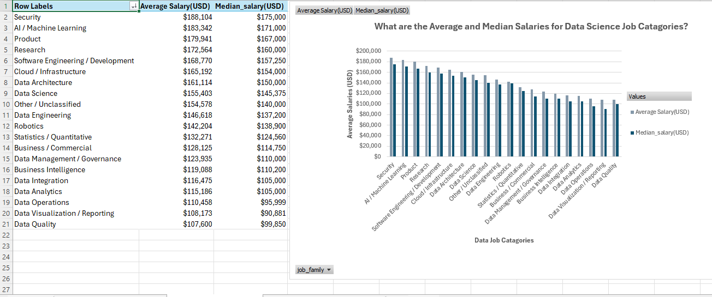

---

### Salary by Experience Level

Salary patterns were analysed across experience levels.

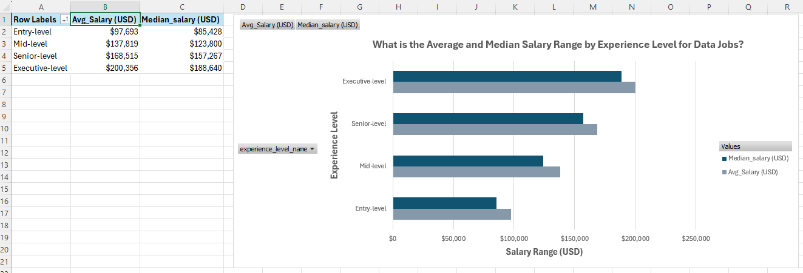

---

### Salary by Work Arrangement

Average and median salary were compared across different work arrangements.

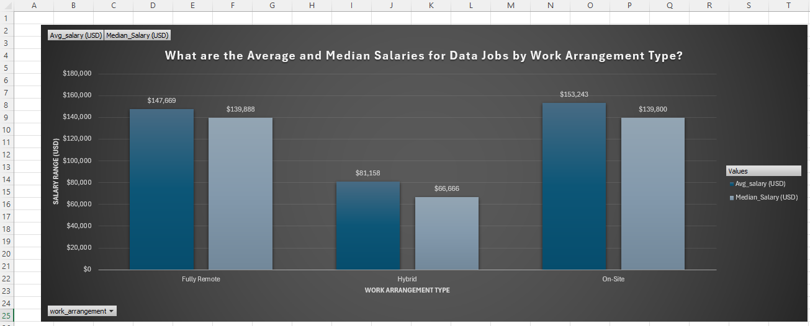

---

### Company Location Distribution

A geographic view was created to identify where the largest concentrations of jobs were located.

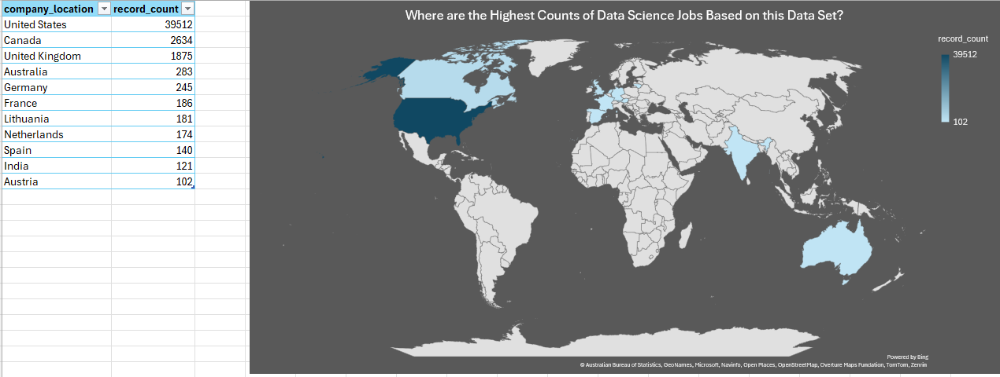

---

## 📊 Tableau Public Dashboards

The final stage of the project was to transform the analysis into two Tableau Public dashboards.

The dashboards were deliberately separated into two views to keep the presentation clean and readable rather than overcrowding a single dashboard.

### Dashboard 1 — Salary Overview

The first dashboard focuses on salary-related insights, including:

* Total job records
* Average annual salary
* Median annual salary
* Salary by work year
* Salary by job category
* Salary by work arrangement
* Salary by employment type

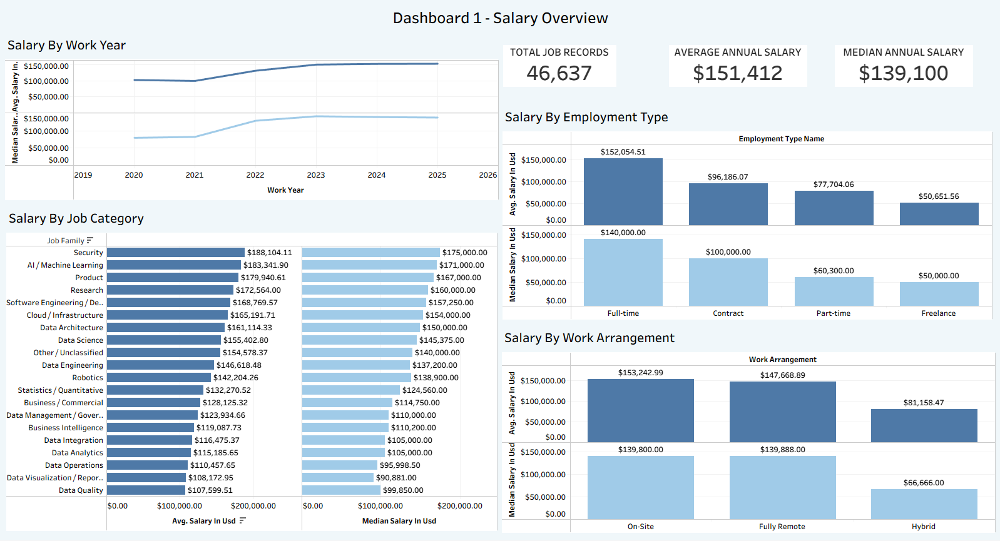

---

### Dashboard 2 — Job Market Overview

The second dashboard focuses on job-market distribution, including:

* Jobs by category
* Jobs by company location
* Job count by experience level

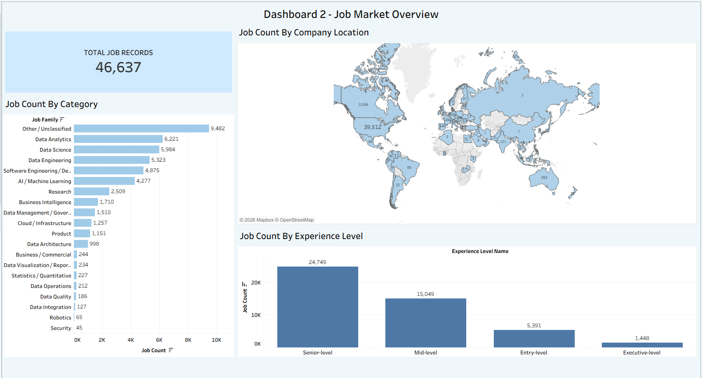

### 🔗 View the Tableau Dashboard

**[View the project on Tableau Public](https://public.tableau.com/views/data_jobs_dashboards/Dashboard1-SalaryOverview?:language=en-US&:sid=&:display_count=n&:origin=viz_share_link)**

---

## 💡 Key Findings

Several patterns emerged from the analysis.

### 💰 Salary Trends

* Average annual salary across the dataset is approximately **$151,412**.
* Median annual salary is approximately **$139,100**.
* Salary levels show an overall increase across the years represented in the dataset.
* Executive-level positions have particularly high average and median salaries.

### 🏢 Work Arrangement

* **On-site positions** represent the largest work-arrangement category.
* **Fully remote roles** represent a significant portion of the dataset.
* **Hybrid positions** represent a comparatively small share of the records.

### 👔 Employment Type

* **Full-time employment** represents the overwhelming majority of records.
* **Contract, part-time** and **freelance** positions account for a much smaller proportion.

### 🧑‍💻 Job Families

Large job-family categories include:

* Data Analytics
* Data Science
* Data Engineering
* Software Engineering
* AI / Machine Learning

The job-family classification provides a more useful view of the market than analysing hundreds of individual job titles independently.

### 🌍 Geographic Distribution

The **United States** accounts for the largest concentration of jobs in the dataset, followed by several other major international markets.

---

## 🔄 End-to-End Workflow

The project followed this workflow:

**Kaggle Dataset**
↓
**Raw Data Import**
↓
**Power Query Cleaning & Transformation**
↓
**Data Validation**
↓
**Job Title Classification**
↓
**Exploratory Analysis**
↓
**Excel PivotTables & Visualisations**
↓
**Tableau Dashboard Development**
↓
**Data Storytelling**

This demonstrates the ability to move from **raw data to a finished analytical product** rather than focusing on visualisation alone.

---

## 🛠️ Tools & Skills

### Tools

* **Microsoft Excel**
* **Power Query**
* **PivotTables**
* **Tableau Public**
* **GitHub**

### Skills Demonstrated

* Data cleaning
* Data transformation
* Data validation
* Data classification
* Exploratory data analysis
* Descriptive statistics
* PivotTable analysis
* Data visualisation
* Dashboard development
* Data storytelling
* Portfolio documentation

---

## 📁 Project Files

### Excel Workbook

The completed Excel workbook is available on OneDrive:

**[View the Excel Workbook](https://1drv.ms/x/c/d642fdee6cef3171/IQBV5ZSxoGoqRKgB5PyHW8OhAdPflTd0yQ6FNR3N-8y0rz4)**

### Tableau Public

**[View the Tableau Public Dashboards](https://public.tableau.com/views/data_jobs_dashboards/Dashboard1-SalaryOverview?:language=en-US&:sid=&:display_count=n&:origin=viz_share_link)**

### Original Dataset

**[View the Kaggle Dataset](https://www.kaggle.com/datasets/saurabhbadole/latest-data-science-job-salaries-2024)**

---

## 📚 What I Learned

This project strengthened my practical understanding of the complete data-analysis workflow.

In particular, I gained further experience in:

* Preparing and validating a large dataset
* Using Power Query to structure messy source data
* Creating meaningful categorical classifications
* Comparing average and median measures
* Using Excel for exploratory analysis
* Designing dashboards with a clear analytical purpose
* Translating analysis into a visual narrative
* Presenting a data project in a professional portfolio format

Most importantly, the project reinforced the importance of **data preparation and analytical thinking before visualisation**.

---

## 👤 About Me

I am transitioning into the data field, driven by a desire to build a more rewarding career while continuously expanding my technical knowledge and skills. 

My goal is to develop the capabilities required for more advanced, technically focused roles that bridge data analytics, data science and, in particular, data engineering. 

Through independent projects and practical application, I am building a strong foundation in data preparation, transformation, analysis and visualization to broaden my skills towards more complex data and engineering challenges.

---

## 🔗 Portfolio

* **[LinkedIn](https://www.linkedin.com/in/damian-olivier-98b92b405)**
* **[Kaggle Dataset](https://www.kaggle.com/datasets/saurabhbadole/latest-data-science-job-salaries-2024)**
* **[Excel Workbook](https://1drv.ms/x/c/d642fdee6cef3171/IQBV5ZSxoGoqRKgB5PyHW8OhAdPflTd0yQ6FNR3N-8y0rz4)**
* **[Tableau Public](https://public.tableau.com/views/data_jobs_dashboards/Dashboard1-SalaryOverview?:language=en-US&:sid=&:display_count=n&:origin=viz_share_link)**

---

### 📌 Project Summary

**46,637 records | 20 job families | 2020–2025 | Excel | Power Query | Tableau Public**

**Raw Data → Clean Data → Analysis → Visualisation → Insight**
